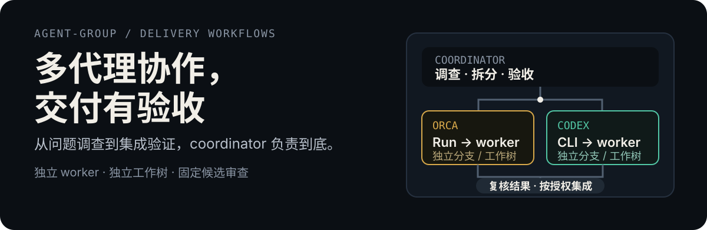
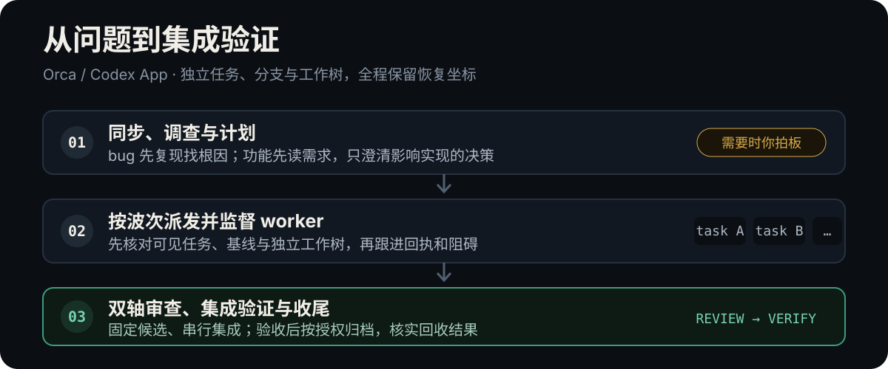

<p align="center">
  
</p>

本仓库提供两个多代理交付技能：**[orca-dispatch](skills/orca-dispatch/SKILL.md)** 面向 [Orca](https://github.com/stablyai/orca)，**[codex-orchestration](skills/codex-orchestration/SKILL.md)** 面向 Codex 原生代理协作。它们都帮助 coordinator 调查问题、拆分任务、监督实施、复核结果并完成集成；具体执行方式和权限边界按各自宿主适配。

技能正文是中文写的，面向中文工作流。

## 它解决什么问题

直接用多个 agent 并行写代码，常见的麻烦是：任务拆得互相踩文件；worker 做完了没人知道；收件箱里的消息被反复读到同一批；"测试通过"只是 worker 自己说的；最后合并时一团乱。

两个技能都把这些写成 coordinator 的固定职责，并遵守各自宿主的能力边界：

- **派发前先想清楚**：修 bug 先造一条能稳定复现的命令再找根因；做新功能先读已有 PRD，没想好就先问清楚、写成 PRD。
- **任务互不重叠**：每个任务是一条能独立验证的窄切片，同一波次内文件不重叠，有依赖就分波次。
- **协调任务**：Orca 版本通过 Run、worker 和消息回执监督；Codex 版本通过原生子代理与任务账本跟踪进度和负责人。
- **验收不靠自述**：coordinator 亲自重跑验证命令，按规范和需求分别审查；集成、清理与推送遵守对应宿主和项目授权。
- **按证据恢复**：中断后依据 Orca 或 Codex 的实际代理状态、Git 状态和已有记录继续，不重做已集成的任务。

## 技能选择

| 技能 | 适用环境 | 协作方式 | 恢复方式 |
|---|---|---|---|
| [orca-dispatch](skills/orca-dispatch/SKILL.md) | 配置了 Orca 的 Claude Code 或 Codex | Orca Run、worker、独立分支 | `继续 <run_id>`，以 Orca 和 Git 状态为准 |
| [codex-orchestration](skills/codex-orchestration/SKILL.md) | Codex | Codex 原生子代理；不伪造 Orca Run/Dispatch | 检查代理、Git 与项目任务账本，从最早未完成步骤继续 |

## 流程

以下图示说明 `orca-dispatch` 的 Orca 流程；Codex 原生流程见 [`codex-orchestration`](skills/codex-orchestration/SKILL.md)。

<p align="center">
  
</p>

| 步骤 | coordinator 做什么 | 你要做什么 |
|---|---|---|
| 0–1 | 同步到最新的默认分支，读项目的 `AGENTS.md` / `CLAUDE.md` / `MEMORY.md`，找出测试和构建命令 | — |
| 2 | **修 bug**：造出会变红的复现命令，列假设、找根因<br>**新功能**：读 PRD 和代码，只问会改变实现的决策 | 回答选项式提问 |
| 3 | 汇报根因或决策、方案、测试切入点、任务拆分表 | 确认计划（加 `先确认` 或需求没想好时） |
| 4–5 | 按窄切片拆任务，建 Run，整波启动 worker | — |
| 6 | 等 `worker_done`，回答 worker 的提问，逐批确认消息 | 只回答转给你的问题 |
| 7–8 | 重跑验证、双轴审查、合并、全量验证、清理 | 推送需要你另外点头 |
| 9 | 把新发现写回 `MEMORY.md` 和 PRD，给出最终汇报 | 看结果 |

## 用法

在 Orca 的终端或 Chat 里打开项目：

```text
/orca-dispatch 素材生成点击后一直转圈，不出结果
/orca-dispatch 实现 docs/PRD.md 第 3 节「批量生成」 先确认
/orca-dispatch 小说素材按免费章节生成文案和图片 先聊清楚
/orca-dispatch 继续 run_3f9c
```

Codex 里调用 Orca 技能时把 `/` 换成 `$`：`$orca-dispatch …`。若使用 Codex 原生代理协作，调用 `$codex-orchestration …`。

| 参数 | 作用 |
|---|---|
| `先聊清楚` | 需求还没想好：不限轮数地问，必要时做一次性原型，问完先写 PRD |
| `先确认` | 计划出来后停下，等你确认再派发 |
| `推送` | 合并验证通过后允许 `git push`；部署永远不会自动执行 |
| `worker 用 opus\|sonnet\|fable\|codex` | 所有 worker 统一用指定模型；不指定时按任务难度自动分配 |
| `继续 <run_id>` | 恢复一次中断的编排 |

需要你选择时，它会优先弹出宿主的原生选择题（Claude Code 的 `AskUserQuestion`、Codex 的 `request_user_input`）；没有时用 `Q1 / A B C` 的文字格式，回 `yes` 或 `1A 2C` 就能答完。

## 安装

这是技能目录，按需复制或软链到对应 agent 会读取的技能目录。以下以仓库根目录为当前目录：

```bash
git clone https://github.com/sys98/agent-group.git
# Claude Code
ln -s "$PWD/agent-group/skills/orca-dispatch" ~/.claude/skills/orca-dispatch
# Codex 等读取 ~/.agents/skills 的 agent
ln -s "$PWD/agent-group/skills/orca-dispatch" ~/.agents/skills/orca-dispatch
```

Codex 原生编排技能：

```bash
# Codex skill directory
ln -s "$PWD/agent-group/skills/codex-orchestration" ~/.codex/skills/codex-orchestration

# Shared agent skill directory
ln -s "$PWD/agent-group/skills/codex-orchestration" ~/.agents/skills/codex-orchestration
```

### 依赖

| 依赖 | 用途 | 来源 |
|---|---|---|
| Orca 与 `orchestration`、`orca-cli` 技能 | `orca-dispatch` 的 worker 派发、收件箱、worktree | Orca 自带 |
| `grilling`、`prototype` | 澄清需求 | [mattpocock/skills](https://github.com/mattpocock/skills) |
| `diagnosing-bugs`、`tdd` | 排查 bug、worker 先写测试 | 同上 |
| `to-tickets`、`code-review` | 切片原则、双轴审查 | 同上 |

`codex-orchestration` 使用 Codex 的原生协作工具；按阶段加载 `grilling`、`prototype`、`diagnosing-bugs`、`to-tickets`、`tdd`、`codebase-design` 与 `code-review`。各宿主实际可用工具和项目规范优先，不把 Orca 专属命令当成 Codex 能力。

`orca-dispatch` 在 Codex 中使用原生选择题时，需要在 `config.toml` 的 `[features]` 下启用 `default_mode_request_user_input = true`（开发中的实验功能）。`codex-orchestration` 是否能调用选择题工具取决于当前会话实际提供的能力。

## 限制

- `orca-dispatch` 已在 Orca 1.4.222、Claude Code 2.1.296、Codex CLI 0.162.1 上按命令帮助逐项核对过；完整的多 worker 编排仍在实际使用中打磨。
- `codex-orchestration` 依赖 Codex 当前会话实际提供的原生代理和任务协调工具；没有 Orca FIFO ack、PTY 唤醒或持久 Run 的等价保证。
- worker 默认是 Claude 模型，分支名要求用中文，这些是作者的工作习惯，按需改 `SKILL.md`。
- 适合单个功能或 bug 的一次交付；跨多天、需要 issue tracker 管理的大工程不是它的目标。
